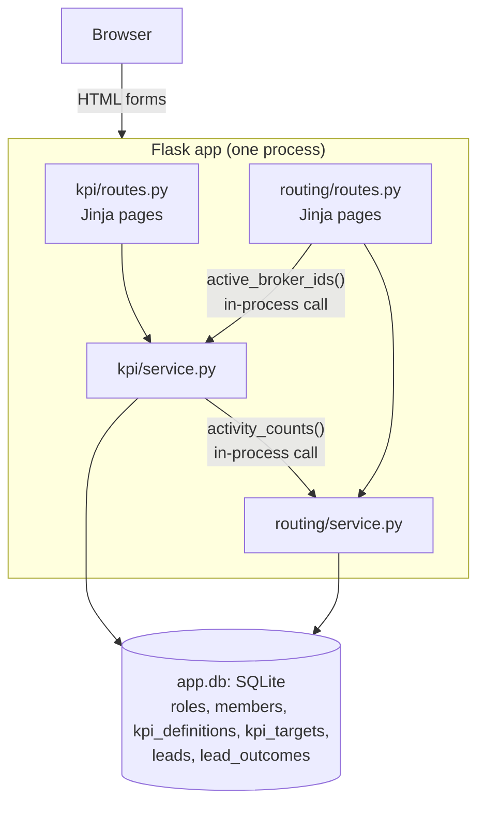
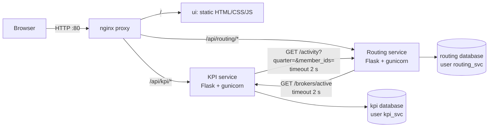
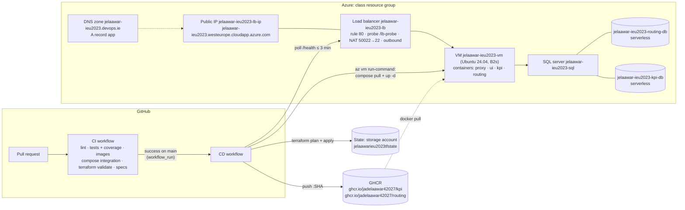
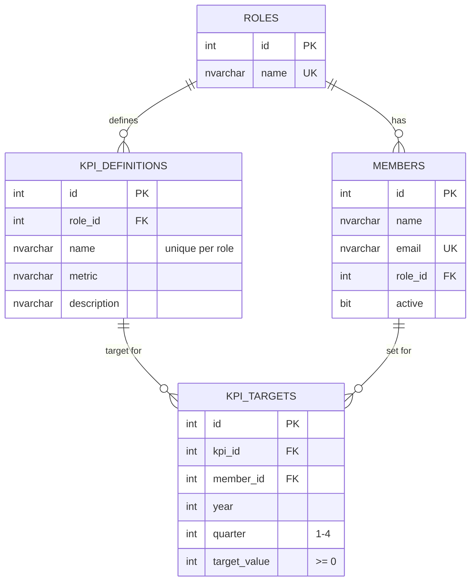
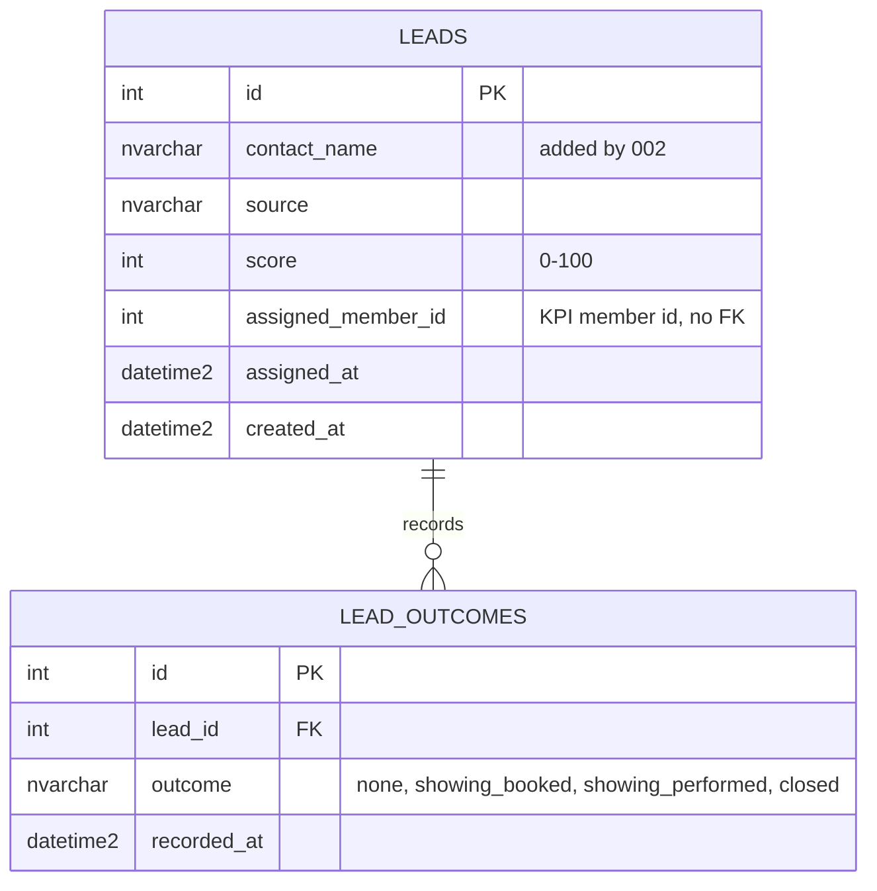

# Split, ship and operate: the brokerage KPI and lead-routing tool

**Student:** Jad El Aawar (jelaawar.ieu2023) · **Course:** Software Development & DevOps, Assignment 2
**Repository:** https://github.com/Jadelaawar42027/devops-teamManagement · **Graded commit:** `submission` tag, SHA [EVIDENCE: full SHA of the tagged commit]
**Live URL:** http://jelaawar-ieu2023.westeurope.cloudapp.azure.com [EVIDENCE: confirm it answers after the final deploy]

> Draft. Every `[EVIDENCE: ...]` marks a screenshot, link or log I still have to take. Replace each one and delete this note before exporting to PDF (4-5 pages).

## 1. What changed, in one paragraph

Assignment 1 was one Flask app with two packages, `kpi` and `routing`, sharing one SQLite file and rendering Jinja pages. Assignment 2 splits it along the seam I drew in ADR-2 into two services, each with its own container, its own SQL Server database and its own database user. A static front end replaces the templates. Everything runs locally with `docker compose up --build`. On Azure it runs on infrastructure created entirely by Terraform from the CD pipeline: a VM behind a load balancer, a DNS zone, and two serverless SQL databases. That replaces Container Apps and Static Web Apps because of the professor's extra requirement (ADR-8). Every push is tested, and every merge to `main` is deployed with no manual step.

## 2. Architecture before and after

**Before (Assignment 1): one process, one database file.** The only links between the domains were two in-process function calls, which the split turned into HTTP.

**After (Assignment 2): two services, two databases, HTTP across the seam.**

The seam held (ADR-6). Exactly two endpoints cross it, both called server side:

- **Dashboard** (`GET /api/kpi/dashboard`): KPI reads targets from its own database, then makes one bulk call to routing's `/activity` for the actuals. If routing does not answer within 2 s, the dashboard still answers 200, with every target shown, `actual` and `percent` set to null, and a notice.
- **New lead** (`POST /api/routing/leads`): routing saves the lead, then asks KPI's `/brokers/active` who can take it. If KPI is down, the lead stays saved without a broker and the response says so. The leaderboard falls back to every member who has leads.

What changed from ADR-2: the per-member `activity_counts()` became a bulk endpoint, so a down routing service costs the dashboard one 2-second timeout instead of one per member. Member names are joined in the browser from KPI's `/members`, and shown as `#id` when KPI is down. The cross-domain foreign key that never existed (ADR-3) is enforced in code: routing only assigns ids it just got from KPI, and KPI only deactivates members, never deletes them (ADR-7).

## 3. Deployment

Terraform in `infra/terraform/` creates these resources: the virtual network, subnet and NSG (port 80 open, SSH only from my IP), the VM (with no public IP of its own), the Standard load balancer with a static public IP, the DNS zone, the SQL server, and two GP_S_Gen5_1 databases (0.5 to 1 vCore, auto-pause after 15 minutes, 2 GB, locally redundant backups). Its state lives in an Azure storage account, so a pipeline run and my laptop see the same state and cannot apply at the same time.

Three design points matter for cost and correctness:

- **The probe must not touch the database.** The load balancer probes `/lb-probe`, which nginx answers itself. Probing `/health` every 15 seconds would write to both databases forever, so they would never auto-pause, and serverless compute would bill around the clock. For the same reason, the production containers have no Docker healthcheck.
- **Cold database, warm containers.** The VM is always on, so there is no container cold start. But the first request after 15 idle minutes finds a paused database, which refuses connections (error 40613) for up to about a minute. `db.py` retries with backoff for about 60 seconds, nginx waits up to 90 seconds, and the post-deploy check allows 3 minutes.
- **Migrations at startup run exactly once.** gunicorn `--preload` runs them before forking workers, and each service has exactly one container, so two copies never race.

The DNS zone is real but not delegated, because I own no domain. It is proven by asking its own name server, which CD also checks on every run:

[EVIDENCE: terminal screenshot of `nslookup app.jelaawar-ieu2023.devops.ie <ns1-xx.azure-dns.com>` returning the load balancer IP]

[EVIDENCE: Azure portal screenshot of the resource group filtered to `jelaawar-ieu2023`, showing the VM, load balancer, public IP, DNS zone, SQL server and both databases]

## 4. Database per service

Each diagram matches the service's migrations: `001_init.sql`, plus `002_add_contact_name.sql` for routing.

*KPI database (`jelaawar-ieu2023-kpi-db`, user `kpi_svc`).*

*Routing database (`jelaawar-ieu2023-routing-db`, user `routing_svc`).* Both databases also hold `schema_migrations(version, applied_at)`. `assigned_member_id` points into the other database, so it cannot have a foreign key (ADR-3, ADR-7).

## 5. Migration evidence on Azure

The first deploy ran only `001` in each database, and the demo seed filled them. Migration `002_add_contact_name.sql` was held back in `later/` until Azure held that data. It changes a table that already holds rows:

1. it adds `leads.contact_name` as nullable,
2. it fills every existing row with `Lead #<id>`,
3. it makes the column `NOT NULL`.

The three steps are separate `GO` batches inside one transaction, so a failure leaves nothing half done. The same change was rehearsed locally on a database already holding the 30 demo leads (30 leads kept, all filled in), and a test runs it against real rows in CI.

| Step | Evidence |
| --- | --- |
| Data before 002 | [EVIDENCE: `/api/routing/leads` JSON or Leads page screenshot from Azure: lead ids, sources, scores, no contact_name] |
| Deployment run | [EVIDENCE: link to the CD run that deployed 002, and its commit SHA] |
| Startup log line | [EVIDENCE: `sudo docker compose -f /opt/app/deploy/docker-compose.prod.yml logs routing \| grep migration` showing `applied migration 002_add_contact_name.sql`, once] |
| Data after 002 | [EVIDENCE: the same leads, same ids, sources and scores, now with `contact_name = "Lead #<id>"`; plus a new lead created with a real contact name] |
| Second boot applies nothing | [EVIDENCE: log line `migrations up to date (2 applied)` after a restart or the next deploy] |

The recovery plan for a bad migration is in ADR-7. Migrations are forward-only: a failing file rolls back and is not recorded, and the fix is a new commit through the pipeline. Damaged data is restored from Azure SQL's point-in-time backups into a new database and copied back.

## 6. Partial failure: what a user sees

With one service stopped, the other keeps serving its own domain, and the flow across the seam degrades in a designed way. CI checks this on every push: it stops each service in the compose stack and runs the integration tests against the result.

| Situation | What the user sees | Evidence |
| --- | --- | --- |
| Routing stopped, Dashboard | Every target still listed. Actuals show "unavailable", with the banner "Routing service unavailable: targets are shown without actuals." The API answers 200 with `activity_available: false`. | [EVIDENCE: screenshot of the dashboard with routing stopped, plus the JSON of `/api/kpi/dashboard`] |
| Routing stopped, Leads page | A clear error banner instead of a blank page. The proxy answers `503 {"error": "Routing service unavailable"}` at once, without hanging. | [EVIDENCE: screenshot] |
| KPI stopped, Add lead | The lead is saved. The result card says "Saved without a broker: KPI service unavailable", and the API answers 201 with `assignment: "skipped"`. | [EVIDENCE: screenshot of the result card, plus the JSON] |
| KPI stopped, Leads / Leaderboard | Brokers appear as `#id`, with a "Broker names unavailable" notice. The leaderboard notice says it ranks every member with leads. | [EVIDENCE: screenshot] |

[EVIDENCE: say where each screenshot was taken: local compose (`docker compose stop routing`) or Azure (stopping a container over SSH)]

## 7. Pipeline evidence

| What | Evidence |
| --- | --- |
| CI passing on the split branch (all jobs: kpi, routing, integration, terraform, specs) | https://github.com/Jadelaawar42027/devops-teamManagement/actions/runs/44559386428 (commit `d498084`) |
| Successful CD run on `main` | [EVIDENCE: link to the CD run, showing images pushed with the SHA tag, terraform apply, DB users, deploy, and the health check passing] |
| A failed run that was fixed, and its cause | [EVIDENCE: link to the failed run, one sentence on the cause, link to the fixing commit and the green run after it] |
| SHA-tagged images | [EVIDENCE: GHCR package page showing `kpi:<sha>` and `routing:<sha>`] |

**What CI gates on** (ADR-9):

- per service: ruff, then pytest against a SQL Server 2022 container, with coverage of `service.py` and `migrate.py` failing under 70% (both are at 100%: kpi 91 tests, routing 93), then `docker build`;
- the cross-seam integration test on the real compose stack, run with both services up, with routing stopped and with KPI stopped, plus a check that a restart applies no migrations;
- `terraform fmt` and `validate`;
- OpenAPI validation of both documents, `system.yaml` against `system.schema.json`, and actionlint.

CI never connects to Azure SQL. **CD** starts only after CI succeeded for a push to `main`, and deploys exactly that commit's SHA. Secrets (the service principal, the SQL passwords) live only in GitHub secrets. On the VM they exist only in a root-only `.env`.

## 8. Decisions and limits

- **Hosting** (ADR-8): a VM and a load balancer are fixed monthly costs, unlike the brief's scale-to-zero design; only the databases pause. This was the price of the professor's requirement. At 100x traffic it would need a scale set of VMs, migrations moved out of startup, and auto-pause turned off.
- **No login** (ADR-10): the public deployment has no authentication and holds demo data only. HTTPS comes first, then single sign-on at the proxy, as soon as real data goes in.
- **Not tested automatically:** the browser UI (checked by hand at desktop and mobile widths), Terraform against real Azure, and a real resume from auto-pause.

## 9. AI disclosure

[EVIDENCE: replace with the exact AI-disclosure statement required by the syllabus, as used in Assignment 1. Draft:] I used Claude Code throughout this assignment, to write and revise code, tests, Dockerfiles, Terraform, workflows and drafts of the documentation. Every prompt, what I accepted or changed, and an explanation of each AI-produced file in my own words are in `AI_USAGE.md`. The design decisions in `ADR.md` are mine, and I checked every file against the running system before submitting.
